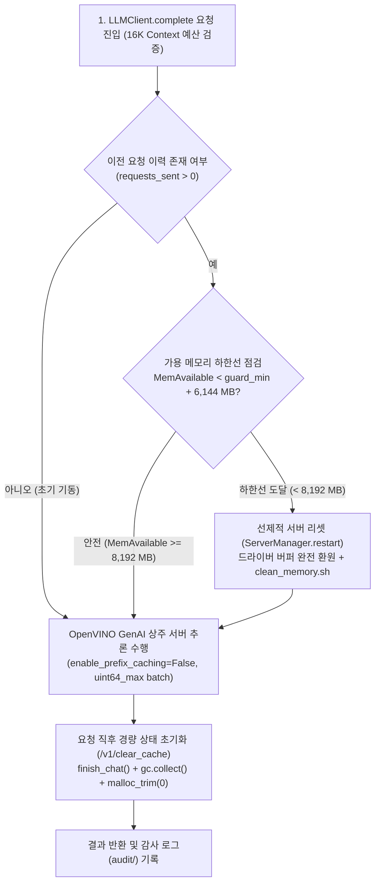

# HDF & SANS Hunt Evil Forensic Benchmark Framework (Option A Resident Architecture)

본 프로젝트는 **Khadas Mind 2 (Intel Core Ultra 7 258V, 32GB LPDDR5X UMA, Intel Arc Xe2 GPU / Level Zero XMX)** 환경에 최적화된 **로컬 LLM 기반 가설 드릴다운 침해사고 포렌식 엔진(`hdf`)** 및 **프로세스 계보(Lineage) 기반 SANS Hunt Evil / MITRE ATT&CK 다중 기법 벤치마크 프레임워크(`exp_i`)**입니다.

모든 판정과 최종 보고서 문장은 원본 이벤트 근거(Citation & Quote Grounding)와 대조 검증되며, **방안 A(Resident Server & Proactive Memory Lifecycle Architecture)**를 통해 32GB 통합 메모리(UMA) 환경에서 26B~27B급 대형 모델의 상주 추론 안정성과 출력 정합성(`100% Parity`)을 동시에 달성합니다.

---

## 1. 핵심 아키텍처: 방안 A (Option A — Resident Server & Proactive Memory Lifecycle)

통합 메모리(UMA) 아키텍처에서 대규모 VLM/LLM(`Gemma-4-26B-OV-INT4`, `Qwen3.8-27B-OV-INT4`, `FoundationSec-8B-Reasoning-OV-INT8`)을 연속 호출할 때 발생하는 KV 캐시 누적 및 Level Zero 드라이버 버퍼 파편화 문제를 해결하기 위해 **3단계 하이브리드 생명주기 제어(방안 A)**를 적용합니다.



### 방안 A의 3대 핵심 메커니즘

1. **스케줄러 정밀 제어 및 서버 상주 구동 (`fresh_server_per_request = false`)**:
   - `server_tools/openvino_server.py`에서 `VLMPipeline` 로드 시 `vlm_scheduler.max_num_batched_tokens = (1 << 64) - 1` 및 `vlm_scheduler.enable_prefix_caching = False`를 명시하여, 프롬프트 분할(Chunked Prefill)로 인한 수치 편차를 방지하고 이전 요청의 KV 블록이 다음 요청에 잔류하지 않도록 차단합니다.
2. **매 요청 직후 경량 상태 및 힙 회수 (`/v1/clear_cache`)**:
   - 모델 가중치는 GPU/UMA 메모리에 상주시킨 상태에서, 매 추론 완료 즉시 `pipe.finish_chat()` + `gc.collect()` + `libc.so.6:malloc_trim(0)`을 수행하여 모델 외 동적 할당 메모리를 즉시 OS로 반환합니다.
3. **가용 메모리 하한선(`safe_floor`) 기반 선제 리셋 & `50ms` `MemoryGuard`**:
   - `hdf/llm.py`에서 매 요청 직전 시스템 `MemAvailable`을 실측하여 `safe_floor = guard_min_available_mb + 6,144 MB` (Gemma 기준 `8,192 MB`, `xetop` UMA 점유율 `68.5%`) 미만으로 내려간 경우에만 선제적으로 서버를 재기동(`restart()`)합니다.
   - 백그라운드 `MemoryGuard`(`hdf/memguard.py`)가 `50ms` 주기로 `/proc/meminfo`를 감시하여 물리 RAM 고갈(OOM)을 원천 차단합니다.

### 방안 A vs 방안 B (매 요청 서버 재기동) 실증 비교 (`Gemma-4-26B-OV-INT4`, `win_bitsadmin_download`)

| 평가 지표 | 방안 B (`fresh_server_per_request = true`) | **방안 A (`fresh_server_per_request = false`)** | 개선 효과 |
| :--- | :---: | :---: | :---: |
| **전 구간 요청 출력 일치율 (`output_eq`)** | 기준선 (`87 / 87`) | **`87 / 87` (`100.0%` 글자 단위 완벽 일치)** | **정합성 손실 `0건`** |
| **서버 기동 횟수 (`Server Starts`)** | `112회` (매 요청 재기동) | **`3회` (초기 기동 1회 + Phase 2 선제 리셋 2회)** | **기동 오버헤드 `97.3%` 제거** |
| **Phase 1 (35개 연속 요청) 소요 시간** | `1,452.50s` (24분 12초) | **`702.40s` (11분 42초, 재기동 `0회`)** | **`2.07배` 가속 (`-51.6%`)** |
| **전체 벤치마크 총 소요 시간** | `2,445.42s` (40분 45초) | **`1,752.29s` (29분 12초)** | **`693.13s` 단축 (`-28.3%`)** |
| **최소 가용 메모리 (`min MemAvailable`)** | `8,400 MB` | **`7,557 MB` (`MemoryGuard` 하한선 대비 `+5,509 MB` 여유)** | **전 구간 OOM / 예외 `0건`** |

---

## 2. 시스템 파이프라인 구조

### 2.1 HDF (Hypothesis Drill-Down Forensics) 코어 엔진 (`hdf/`)

| 단계 | 수행 작업 | 사용 모델 |
| :--- | :--- | :--- |
| **Phase 0: Ingest** | JSONL, JSON(`Records`), CSV, EVTX, Syslog, `.gz`, `.zip` 전수 파싱 → SQLite + Trigram 인덱스(`evidence.db`) 구축 및 UTC 타임스탬프 정렬, 동형 이벤트 패턴 그룹화 | 없음 (코드 연산) |
| **Phase 1: Triage** | 모델 토크나이저 기준 최대 `12,288` 입력 토큰 예산 내 가변 패킹(로그 절단 없음), 인용(`quote`) 및 엔티티 바인딩 검증, 누락 라인 재질의(Recursive Re-ask) | `models.triage` |
| **Phase 2: Reduce & Hypothesize** | 검증된 이상 징후(Findings)를 계층적으로 병합하고, 증거 스토어에 존재하는 엔티티만 참조하는 공격 가설 및 검증 쿼리 생성 | `models.reasoner` |
| **Phase 3: Drill-Down & Feedback** | 전체 `evidence.db` 대상 검색 수행, 반증(Refuted)/미검증 가설 피드백 루프 및 피벗 확장 | `models.reasoner` |
| **Phase 4: Report & Verify** | `SUPPORTED` 가설만 최종 보고서(`report.md`, `report.json`)로 채택하며, 모든 문장의 인용 이벤트 포함 여부를 코드로 재검증(`verification.json`) | `models.reasoner` + 검증기 |

### 2.2 Experiment I & SANS Hunt Evil 5-Method 벤치마크 (`proposals/2026-10-11/exp_i/`)

1. **Phase 1 (Process-Instance Lineage Triage)**:
   - `PPID → PID` 프로세스 트리 복원 및 시간순(`ts_epoch`) 정렬 후, 프로세스 인스턴스 단위로 문맥을 보존하여 가변 패킹(`max_input_tokens <= 12,288`, `prompt + expected_output <= 16,384`)합니다.
   - 인용구(`quote`)가 원본 이벤트 라인과 정확히 바인딩된 판정만 채택하며, 연결된 프로세스 참조(`linked_pids`)를 통해 재귀적 재검증(`recursive_recheck`)을 수행합니다.
2. **Phase 2 (MITRE ATT&CK Technique Attribution — 5종 기법 비교)**:
   - **Method 1 (Baseline)**: 전체 222개 상위(Parent) ATT&CK 기법 카탈로그 제시 후 2단계(Select → Official Description & Sub-technique Verify) 검증
   - **Method 2 (Track 1 — TF-IDF RRF Semantic RAG)**: 순수 파이썬 기반 라인별 TF-IDF + Reciprocal Rank Fusion(RRF) 검색기로 상위 30개 후보 기법만 압축 제시 후 2단계 검증
   - **Method 3 (Track 2 — All-Groups 2-Pass CoT)**: 전체 공격 그룹 대상 2-Pass Chain-of-Thought(정상 OS 동작 vs 침해 행위 분석 후 기법 매핑) + 2단계 검증
   - **Method 4 (Track 2 — Active-Lineage 2-Pass CoT)**: 능동 실행 지표(`CommandLine`, `NewProcessId`, `DestinationIp`)를 포함한 Active Lineage 그룹 필터링 + 2-Pass CoT + 2단계 검증
   - **Method 5 (Track 3 — Hybrid Active + RAG + CoT)**: Active Lineage 필터링 + TF-IDF RRF Top-30 RAG + 2-Pass CoT + 2단계 검증

---

## 3. 다중 모델 × 다중 데이터셋 실증 벤치마크 결과

* **평가 환경**: Khadas Mind 2 (Intel Core Ultra 7 258V, 32GB LPDDR5X, Arc Xe2 GPU, OpenVINO GenAI, `context_tokens = 16,384`)
* **평가 모델**: `FoundationSec-8B-Reasoning-OV-INT8`, `Gemma-4-26B-OV-INT4`, `Qwen3.8-27B-OV-INT4`

### 3.1 `win_bitsadmin_download` (Ground Truth: `T1197` BITS Jobs)
| Model | P1 Recall (Direct / Total) | P1 FP (FPR) | P1 F1 | M1 (Baseline) | M2 (RAG) | M3 (All CoT) | M4 (Active CoT) | M5 (Hybrid) |
| :--- | :---: | :---: | :---: | :---: | :---: | :---: | :---: | :---: |
| **FoundationSec-8B** | 92.86% / 92.86% | 30 (34.09%) | 61.90% | MISS (FP:10, F1:0.0%) | EXACT (FP:8, F1:20.0%) | EXACT (FP:8, F1:20.0%) | EXACT (FP:3, F1:40.0%) | **EXACT (FP:1, F1:66.67%)** |
| **Gemma-4-26B** | **100.0% / 100.0%** | 56 (63.64%) | 50.00% | EXACT (FP:2, F1:50.0%) | **EXACT (FP:0, F1:100.0%)** | EXACT (FP:7, F1:22.22%) | EXACT (FP:2, F1:50.0%) | EXACT (FP:2, F1:50.0%) |
| **Qwen3.8-27B** | **100.0% / 100.0%** | **22 (25.00%)** | **71.79%** | EXACT (FP:4, F1:33.33%) | **EXACT (FP:0, F1:100.0%)** | EXACT (FP:2, F1:50.0%) | EXACT (FP:2, F1:50.0%) | **EXACT (FP:1, F1:66.67%)** |

### 3.2 `win_remote_schtask` (Ground Truth: `T1053.005` Scheduled Task, `T1021` Remote Services)
| Model | P1 Recall (Direct / Total) | P1 FP (FPR) | P1 F1 | M1 (Baseline) | M2 (RAG) | M3 (All CoT) | M4 (Active CoT) | M5 (Hybrid) |
| :--- | :---: | :---: | :---: | :---: | :---: | :---: | :---: | :---: |
| **FoundationSec-8B** | 66.67% / 66.67% | 49 (63.64%) | 54.55% | EXACT (FP:8, F1:33.33%) | **EXACT (FP:6, F1:40.0%)** | EXACT (FP:11, F1:15.38%) | EXACT (FP:6, F1:25.0%) | EXACT (FP:9, F1:18.18%) |
| **Gemma-4-26B** | **100.0% / 100.0%** | 56 (72.73%) | 69.23% | EXACT (FP:7, F1:22.22%) | EXACT (FP:6, F1:25.0%) | EXACT (FP:7, F1:22.22%) | EXACT (FP:5, F1:28.57%) | **EXACT (FP:8, F1:33.33%)** |
| **Qwen3.8-27B** | 85.71% / 85.71% | **32 (41.56%)** | **72.48%** | EXACT (FP:7, F1:22.22%) | EXACT (FP:5, F1:28.57%) | **EXACT (FP:4, F1:33.33%)** | **EXACT (FP:4, F1:33.33%)** | EXACT (FP:6, F1:25.0%) |

### 3.3 `win_auditpol_disable` (Ground Truth: `T1562.002` Disable Windows Event Logging)
| Model | P1 Recall (Direct / Total) | P1 FP (FPR) | P1 F1 | M1 (Baseline) | M2 (RAG) | M3 (All CoT) | M4 (Active CoT) | M5 (Hybrid) |
| :--- | :---: | :---: | :---: | :---: | :---: | :---: | :---: | :---: |
| **FoundationSec-8B** | 65.26% / 65.26% | 16 (32.00%) | 71.68% | PARENT (FP:1, F1:66.67%) | MISS (FP:4, F1:0.0%) | EXACT (FP:4, F1:33.33%) | EXACT (FP:3, F1:40.0%) | PARENT (FP:2, F1:50.0%) |
| **Gemma-4-26B** | **100.0% / 100.0%** | **0 (0.00%)** | **100.0%** | MISS (FP:1, F1:0.0%) | MISS (FP:0, F1:0.0%) | EXACT (FP:3, F1:57.14%) | EXACT (FP:3, F1:57.14%) | **EXACT (FP:2, F1:66.67%)** |
| **Qwen3.8-27B** | **100.0% / 100.0%** | 4 (8.00%) | 97.94% | MISS (FP:3, F1:0.0%) | MISS (FP:2, F1:0.0%) | EXACT (FP:4, F1:33.33%) | EXACT (FP:4, F1:33.33%) | **EXACT (FP:2, F1:50.0%)** |

---

## 4. 디렉토리 구조 (Repository Layout)

```text
forensics-option-a/
├── README.md                          # 프로젝트 메인 문서 (방안 A 아키텍처 및 벤치마크 가이드)
├── requirements.txt                   # Python 패키지 의존성 목록
├── hdf.toml                           # Khadas Mind 2 머신 설정 (방안 A 기본 적용)
├── hypothesis_drilldown_forensics.py  # HDF 메인 CLI 엔트리포인트
├── hdf/                               # HDF 코어 엔진 패키지
│   ├── __main__.py, cli.py            # CLI 명령 파서 (run, ingest, verify)
│   ├── default_config.toml            # 엔진 전체 기본 설정 명세 (16K 컨텍스트 예산 등)
│   ├── ingest.py, store.py, timeparse.py # 다중 포맷 로그 파서 및 SQLite + Trigram 증거 스토어
│   ├── triage.py, investigate.py      # Phase 1 트리아지 및 Phase 2~3 가설 드릴다운 루프
│   ├── grounding.py, verify.py, attack.py # 인용구/엔티티/MITRE ATT&CK STIX 무결성 검증기
│   ├── llm.py, memguard.py            # 방안 A 상주 서버 클라이언트, 선제 리셋 및 50ms 메모리 가드
│   ├── prompts.py, schemas.py, output_schemas.py # 100% 추상화된 포렌식 프롬프트 및 JSON 스키마
│   └── tests/                         # 오프라인 단위/파이프라인 테스트 스위트
├── hdf_eval/                          # OTRF Security-Datasets 자동 수집 및 평가 모듈
├── server_tools/
│   └── openvino_server.py             # OpenVINO GenAI (VLMPipeline/LLMPipeline) OpenAI 호환 서버
├── scripts/
│   └── clean_memory.sh                # 프로세스 전수 회수 및 커널 페이지 캐시/메모리 컴팩션 스크립트
└── proposals/
    ├── 2026-10-09/exp_f/scripts/f_lib.py # 공통 인용 바인딩 및 스키마 유틸리티
    ├── 2026-10-10/exp_h/              # 벤치마크 데이터셋 정답 라벨(labels/) 및 샘플(samples/)
    └── 2026-10-11/exp_i/              # 방안 A 기반 프로세스 계보 트리아지 & 5-Method 벤치마크
        ├── OVERNIGHT_BENCHMARK_REPORT.md # 3모델 × 3데이터셋 × 5기법 최종 벤치마크 리포트
        ├── CHANGELOG.md, TUNING.md    # 실험 설계 및 파라미터 튜닝 이력
        ├── FROZEN.sha256              # 코어 실험 스크립트 및 라벨 무결성 해시
        ├── profiles/                  # 모델별 프로필 (final_fsec.toml, final_gemma.toml, final_qwen.toml 등)
        ├── samples/, scores/          # 샘플 정의 및 채점 산출물
        └── scripts/
            ├── run_sans_benchmark.py  # Phase 1 계보 트리아지 + Phase 2 5-Method 통합 벤치마크 하네스
            ├── overnight_runner.py    # 다중 모델·데이터셋 무인 연속 실행 및 리포트 생성 오케스트레이터
            ├── run_i.py, conclude_v2.py, i_lib.py, score_i.py # Exp I 핵심 모듈
            └── test_offline.py        # 136개 오프라인 무결성 검증 테스트 스위트
```

---

## 5. 설치 및 실행 방법 (Getting Started)

### 5.1 환경 구성

```bash
python3 -m venv venv
venv/bin/pip install -r requirements.txt
```

MITRE ATT&CK STIX 데이터셋 및 OTRF 평가 데이터셋을 준비할 경우:
```bash
venv/bin/python3 -m hdf_eval list
venv/bin/python3 -m hdf_eval fetch all
```

### 5.2 모델 가중치 준비 및 저장 경로 설정 (Model Weights Setup)

본 저장소에는 대용량 모델 가중치(총 `약 37.6 GB`)가 포함되어 있지 않으므로, 추론 서버 및 벤치마크를 실행하기 전에 아래 3종의 OpenVINO IR 모델을 준비하여 지정된 경로에 배치해야 합니다.

#### (1) 사용 모델 3종 명세 및 기본 저장 위치

기본 설정 파일들은 **`/home/ubuntu/llama-models/`** 하위 경로를 참조하도록 구성되어 있습니다.

| 모델 역할 / 프로필 | 로컬 저장 디렉토리 경로 (`path`) | 원본 HuggingFace 모델 ID | 포맷 / 정밀도 | 용량 |
| :--- | :--- | :--- | :---: | :---: |
| **FoundationSec-8B** (`final_fsec`) | `/home/ubuntu/llama-models/FoundationSec-8B-Reasoning-OV-INT8` | `fdtn-ai/Foundation-Sec-8B-Reasoning` | OpenVINO IR (`INT8`) | `7.6 GB` |
| **Gemma-4-26B** (`final_gemma`) | `/home/ubuntu/llama-models/Gemma-4-26B-OV-INT4` | `OpenVINO/gemma-4-26B-A4B-it-int4-ov` (원본: `google/gemma-4-26B-A4B-it`) | OpenVINO IR (`INT4_ASYM`, group 128) | `15.0 GB` |
| **Qwen3.8-27B** (`final_qwen`) | `/home/ubuntu/llama-models/Qwen3.8-27B-OV-INT4` | `OpenVINO/Qwen3.8-27B-int4-ov` (원본: `Qwen/Qwen3.8-27B`) | OpenVINO IR (`INT4_ASYM`, group 128) | `15.0 GB` |

#### (2) 모델 가중치 다운로드 및 변환 명령어

```bash
mkdir -p /home/ubuntu/llama-models

# 1. Gemma-4-26B-OV-INT4 (OpenVINO 공식 사전 변환 모델 다운로드)
venv/bin/huggingface-cli download OpenVINO/gemma-4-26B-A4B-it-int4-ov \
    --local-dir /home/ubuntu/llama-models/Gemma-4-26B-OV-INT4

# 2. Qwen3.8-27B-OV-INT4 (OpenVINO 공식 사전 변환 모델 다운로드)
venv/bin/huggingface-cli download OpenVINO/Qwen3.8-27B-int4-ov \
    --local-dir /home/ubuntu/llama-models/Qwen3.8-27B-OV-INT4

# 3. FoundationSec-8B-Reasoning-OV-INT8 (원본 모델을 OpenVINO INT8로 변환)
venv/bin/optimum-cli export openvino \
    --model fdtn-ai/Foundation-Sec-8B-Reasoning \
    --weight-format int8 \
    /home/ubuntu/llama-models/FoundationSec-8B-Reasoning-OV-INT8
```

각 모델 폴더 내부에는 OpenVINO GenAI 런타임이 로드하는 `openvino_model.xml` / `openvino_model.bin` (VLM의 경우 `openvino_language_model.xml` / `.bin`), `openvino_tokenizer.xml` / `.bin`, `openvino_detokenizer.xml` / `.bin`, `config.json`, `tokenizer.json`, `chat_template.jinja` 파일이 위치해야 합니다.

#### (3) 다른 경로에 가중치를 저장할 경우 수정해야 할 설정 파일

모델 가중치를 `/home/ubuntu/llama-models/`가 아닌 다른 디렉토리에 저장한 경우, 아래 설정 파일들의 `[models.triage]` 및 `[models.reasoner]` 섹션 내 `path` 값을 해당 경로로 수정하십시오:

- **HDF 메인 설정**: [`hdf.toml`](hdf.toml) (`18`행, `27`행)
  ```toml
  [models.triage]
  name = "FoundationSec-8B-Reasoning-OV-INT8"
  path = "/원하는/모델/경로/FoundationSec-8B-Reasoning-OV-INT8"

  [models.reasoner]
  name = "Gemma-4-26B-OV-INT4"
  path = "/원하는/모델/경로/Gemma-4-26B-OV-INT4"
  ```
- **SANS 벤치마크 모델별 프로필**:
  - [`proposals/2026-10-11/exp_i/profiles/final_fsec.toml`](proposals/2026-10-11/exp_i/profiles/final_fsec.toml) (`22`행, `33`행)
  - [`proposals/2026-10-11/exp_i/profiles/final_gemma.toml`](proposals/2026-10-11/exp_i/profiles/final_gemma.toml) (`21`행, `30`행)
  - [`proposals/2026-10-11/exp_i/profiles/final_qwen.toml`](proposals/2026-10-11/exp_i/profiles/final_qwen.toml) (`21`행, `30`행)

### 5.3 오프라인 무결성 및 단위 테스트 실행 (서버 기동 불필요)

```bash
# 1. HDF 코어 엔진 단위/파이프라인 테스트 (60개 테스트)
venv/bin/python3 -m unittest discover -s hdf/tests -t .

# 2. Experiment I 오프라인 검증 스위트 (136개 체크 + FROZEN.sha256 해시 검증)
venv/bin/python3 proposals/2026-10-11/exp_i/scripts/test_offline.py
(cd proposals/2026-10-11/exp_i && sha256sum -c FROZEN.sha256)
```

### 5.4 방안 A 기반 SANS 5-Method 벤치마크 실행

```bash
# 단일 데이터셋 및 단일 모델(예: Gemma-4-26B 상주 모드) 벤치마크 실행
venv/bin/python3 proposals/2026-10-11/exp_i/scripts/run_sans_benchmark.py \
    --dataset win_bitsadmin_download \
    --models final_gemma

# 3종 모델 × 3종 데이터셋 전체 벤치마크 연속 실행 및 리포트 자동 생성
venv/bin/python3 proposals/2026-10-11/exp_i/scripts/overnight_runner.py
```

### 5.5 HDF 전체 침해사고 조사 파이프라인 실행

```bash
# 증적 디렉토리 전체 인제스트 → 트리아지 → 가설 드릴다운 → 보고서 생성 및 검증
venv/bin/python3 hypothesis_drilldown_forensics.py run <evidence_dir> \
    --config hdf.toml \
    --out hdf_runs/<run_name>

# 생성된 보고서의 인용 및 증거 정합성 독립 재검증
venv/bin/python3 hypothesis_drilldown_forensics.py verify hdf_runs/<run_name> --config hdf.toml
```

### 5.6 프로세스 및 메모리 완전 회수

```bash
bash scripts/clean_memory.sh
```
