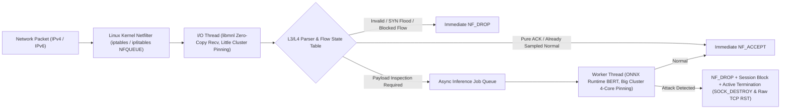

# Real-Time Inline Packet Inspection & Active IPS Framework (NFQUEUE + ONNX Runtime BERT)

리눅스 커널 Netfilter(`NFQUEUE`)와 C 네이티브 `libmnl` 및 **ONNX Runtime C API**를 결합하여, 인라인(In-line) 네트워크 경로(`INPUT` 및 라우터 `FORWARD`)에서 실시간으로 IPv4/IPv6 패킷을 가로채고 BERT 기반 딥러닝 모델로 공격 여부를 판별하여 즉시 차단(`NF_DROP` + `SOCK_DESTROY` + Raw TCP `RST`)하는 침입 방지 시스템(IPS) 실험 프로젝트입니다.

---

## 1. 시스템 아키텍처 및 동작 구조



### 핵심 설계 특징
1. **비동기 2-계층 스레드 분리 및 ARM64 Big.LITTLE 코어 피닝 (`detect_cpu_clusters`)**:
   - **I/O 수신 스레드**: 고효율(Little) 코어에 고정되어 커널 `NFQUEUE`로부터 패킷을 수신하고, L3/L4 파싱·세션 조회·핸드셰이크/빈도 제한 검사를 마이크로초($\mu\text{s}$) 단위로 즉시 처리합니다.
   - **ONNX 추론 워커 스레드**: 고성능(Big) 4코어 클러스터에 스레드 풀을 고정하여 L7 페이로드가 포함된 패킷만 비동기 큐(`job_queue`)를 통해 BERT 추론을 수행합니다.
2. **양방향 5-Tuple 정규화 세션 테이블 (`g_sess`) 및 3단계 우선순위 해시 축출**:
   - 송수신 방향에 무관하게 동일한 플로우 키를 생성하는 정규화(`make_flow_key`)를 적용합니다.
   - 해시 버킷(`TABLE_PROBE = 32`) 포화 시 `BLOCKED` 세션을 절대 보호하며, **`half-open` $\rightarrow$ `closing` $\rightarrow$ `ESTABLISHED` (최소 `last_seen` LRU)** 순서로 슬롯을 교체합니다.
3. **다중 패킷 연속 검증 및 주기적 재검사 (Anti-Evasion)**:
   - 신규 연결 수립 후 초기 `VERIFY_PKTS_TARGET`(기본 3개) 페이로드 패킷이 **연속으로 `Normal`** 판정을 받아야만 `ESTABLISHED` 상태로 승격됩니다. 중간에 임계값 미달 의심 패킷 유입 시 누적 검증 카운터(`verified_pkts`)는 즉시 `0`으로 리셋됩니다.
   - `ESTABLISHED` 승격 이후에도 매 `SAMPLE_INTERVAL`(기본 8번째) 페이로드마다 주기적 재검사를 수행하여 세션 중간 공격 주입(Mid-stream Injection)을 탐지합니다.
4. **능동적 양방향 세션 즉시 종료 (`terminate_blocked_tcp`)**:
   - 공격 패킷 탐지 시 단순히 해당 패킷만 `NF_DROP`하는 데 그치지 않고:
     - **로컬 호스트(`INPUT`) 경유 시**: `NETLINK_SOCK_DIAG` (`SOCK_DESTROY`)를 호출하여 서버의 커널 TCP 소켓을 즉시 강제 종료합니다.
     - **라우터(`FORWARD`) 경유 시**: `IP_HDRINCL`(IPv4) 및 `IPV6_HDRINCL`(IPv6) 원시 소켓(`SOCK_RAW`)을 통해 클라이언트와 원격 서버 양방향으로 위조된 5-Tuple `TCP RST` 패킷(`send_raw_rst4`, `send_raw_rst6`)을 전송하여 양단 연결을 즉시 해제합니다.

---

## 2. 탑재 모델 및 헤더 특징 정규화 규격

### 2.1 탑재 모델 스펙 (`models/et_bert.onnx`)
- **기반 모델**: `rdpahalavan/bert-network-packet-flow-header-payload` (`BERT-base-cased` 아키텍처, 12 Layers, 108M Parameters)
- **입출력 텐서 규격**:
  - 입력: `input_ids` (`int64[1, 128]`), `attention_mask` (`int64[1, 128]`)
  - 출력: `logits` (`float32[1, 24]`) — `Normal`(1개) 및 23개 네트워크 공격 클래스(`DoS`, `DDoS`, `PortScan`, `SQL Injection`, `Brute Force`, `Infiltration` 등 총 24개 클래스)
- **C 네이티브 WordPiece 토크나이저**:
  - `models/encryptd_vocab.txt` (28,996개 어휘)를 65,536 슬롯 해시 테이블로 메모리에 적재하여 외부 Python 의존성 없이 C 런타임에서 직접 토큰화를 수행합니다.

### 2.2 RFC 791/793/6335 기반 헤더 특징 정규화 (Positional Shift 방지)
모델 입력 시 L7 페이로드 바이트 열(10진수 문자열) 앞에 주입되는 13개 플로우/헤더 정수 특징에서, 클라이언트 임시 포트(`1024..65535`), TCP 옵션 길이(`doff=8` 등), 라우팅 홉(`TTL`)에 의해 WordPiece 서브워드 토큰 분할 개수가 달라져 뒤따르는 페이로드 토큰의 포지셔널 임베딩(`position_ids`)이 밀리는 현상(Feature Contamination & Positional Shift)을 방지하기 위해 다음과 같이 정규화합니다:
- L3/L4 상태 머신 및 방화벽 정책은 **실제 패킷 헤더**로 엄격히 검증
- 모델 입력용 13개 헤더 토큰은 RFC 표준 기본 헤더 규격(`can_doff = 5`, `can_iplen = 40 + payload_len`, `can_ttl = 64`, `can_tos = 0`, `can_flags = 24`, 임시 포트 `>= 1024`는 단일 토큰 `50000`으로 정규화, 서비스 포트 `dst_port` 원형 보존)으로 정규화하여 포트·옵션·TTL 변화에 대해 100% 불변(Invariant)인 분류 일관성을 보장합니다.

---

## 3. 실험 및 검증 결과

컴파일 옵션 `-O2 -Wall -Wextra` 무경고 빌드 환경에서 **Tier 1 White-Box 단위 테스트(`U1`~`U11`)** 및 **Tier 2 실네트워크 통합 테스트(`INPUT` 및 3-네임스페이스 라우터 `FORWARD`, `IT1`~`IT9`)** 전 항목을 검증하였습니다.

### 3.1 Tier 1: White-Box 단위 검증 스위트 (`--self-test`)

| 테스트 ID | 검증 항목 및 실험 통제 조건 | 결과 |
| :--- | :--- | :---: |
| **`U10`** | WordPiece 28,996개 어휘 해시 적재 무결성(`failed=0`), 200B 초장문 단어 경계 안전성, ONNX 모델 로드 | **PASS** |
| **`U1`** | IPv4/IPv6 파서, `doff=5`/`doff=8`, 비첫 단편(`PARSE_FAIL`), IPv6 원자적 단편(`PARSE_OK`), ICMPv6(`PARSE_OTHER`) | **PASS** |
| **`U2`** | 미등록 플로우 데이터 패킷 및 `SYN+ACK` 즉시 차단(`drop_unknown_flow=2`), `SYN` $\rightarrow$ 데이터 수신 시 `g_halfopen_total` 회수(`0`) | **PASS** |
| **`U3`** | **포트/옵션/TTL 불변성**: 12개 클라이언트 포트(`1024..65535`) $\times$ `doff={5,8}` $\times$ `ttl={64,63,52,128}` 조합(120회 추론)에서 정상 HTTP 전수 `Normal`, 원본 106B 단문 SQLi(`doff=5`) 전수 공격 판정 및 세션 즉시 차단 | **PASS** |
| **`U4`** | IP당 동시 half-open 상한(`drop_halfopen_ip=2`), 초당 신규 플로우 상한 초과(`drop_rate_exceeded=1`) 및 자동 IP 차단(`drop_ip_blocked=1`) | **PASS** |
| **`U5`** | `Normal` 2회(`verified_pkts=2`) 후 임계값 미달 `SSH Patator` 유입 시 `verified_pkts == 0` 리셋 및 `SESSION_STATE_NEW` 유지 검증, 해시 버킷 32슬롯 포화 시 LRU 축출 및 Fail-Closed 검증 | **PASS** |
| **`U6`** | 세션 테이블(`g_sess`) 동일 버킷 32슬롯 완전 포화 시 `half-open` $\rightarrow$ `closing` $\rightarrow$ `ESTABLISHED`(LRU) 순서 축출 및 `BLOCKED` 세션 보호 검증 | **PASS** |
| **`U7`** | `/proc/net/tcp` 및 `/proc/net/tcp6` 기수립(`ESTABLISHED`) 세션 파싱 및 등록 | **PASS** |
| **`U8`** | 추론 작업 대기열 포화(`job_queue_max=2`) 시 초과 패킷 즉시 `NF_DROP`(`drop_job_queue_full=1`) 및 세션 상태 롤백 | **PASS** |
| **`U9`** | 2,000B 대형 공격 패킷 16진수 덤프 기록 시 버퍼 상한(`<4096B`) 안전 절단 및 파일 생성 확인 | **PASS** |
| **`U11`** | `send_raw_rst6()`가 조립한 60B IPv6(`IPV6_HDRINCL`)+TCP RST 패킷의 파서 통과 및 IPv6 의사 헤더 체크섬(`0`) 검증 | **PASS** |

### 3.2 Tier 2: 실네트워크 통합 검증 스위트 (`INPUT` & 3-Netns `FORWARD`)
모든 가상 인터페이스(`veth`)에서 하드웨어 오프로딩(`tx/rx/tso/gso/gro off`)을 비활성화하여 실제 라우터 패킷 경계를 재현한 상태에서 검증을 수행하였습니다.

| 테스트 ID | 토폴로지 | 검증 시나리오 | 결과 |
| :--- | :---: | :--- | :---: |
| **`IT1`** | `INPUT` | `--ready-file` 동기화 기동 및 `iptables`/`ip6tables` NFQUEUE(Queue 17) 무경합 주입 | **PASS** |
| **`IT2`** | `INPUT` | NFQUEUE 주입 전 수립된 기수립 연결에서 20회 연속 Keep-Alive 요청 및 주기적 샘플링 재검사(3회) 무중단 통과 (`20/20 200 OK`) | **PASS** |
| **`IT3`** | `INPUT` | `SYN` 핸드셰이크 없는 비정상 원시 `PSH\|ACK` 데이터 패킷 즉시 차단 (`drop_unknown_flow=1`) | **PASS** |
| **`IT4`** | `INPUT` | 신규 IPv4 Keep-Alive 세션 10회 연속 요청 (초반 3패킷 연속 검증 후 `ESTABLISHED` 승격, `10/10 200 OK`) | **PASS** |
| **`IT5`** | `INPUT` | 정상 요청 후 동일 세션으로 106B 단문 SQLi 주입 시 즉시 `NF_DROP` + 클라이언트 `RST` + 서버 `SOCK_DESTROY` 소켓 파괴 (`잔류 소켓 0개`) | **PASS** |
| **`IT6`** | `INPUT` | IPv6 정상 HTTP 요청 통과 및 IPv6 SQLi+Shellshock 공격 패킷 즉시 차단/세션 해제 | **PASS** |
| **`IT7`** | `INPUT` | 공격자 IP(`10.200.1.99`) 30회 SYN Flood 차단(`drop_rate_exceeded=1`, `drop_ip_blocked=9`) 중 정상 클라이언트(`10.200.1.2`) 무중단 통신 유지 | **PASS** |
| **`IT8`** | `INPUT` | 종료 시 전체 카운터 정합성 검증 (`enobufs=0`, `verdict_fail=0`, `drop_infer_error=0`) | **PASS** |
| **`IT9-v4`** | `FORWARD` (`3-Netns`) | `ns_client` $\leftrightarrow$ `ns_router` $\leftrightarrow$ `ns_server` 환경에서 IPv4 SQLi 차단 및 양방향 Raw TCP RST(`send_raw_rst4`)를 통한 원격 서버 소켓 즉시 해제 (`잔류 소켓 0개`) | **PASS** |
| **`IT9-v6`** | `FORWARD` (`3-Netns`) | `ns_client` $\leftrightarrow$ `ns_router` $\leftrightarrow$ `ns_server` 환경에서 IPv6 SQLi 차단 및 `IPV6_HDRINCL` 기반 60B Raw IPv6 TCP RST(`send_raw_rst6`)를 통한 원격 서버 소켓 즉시 해제 (`잔류 소켓 0개`) | **PASS** |

---

## 4. 디렉토리 구조

```text
router/
├── packet_collect.c          # 메인 IPS 엔진 및 Tier 1 단위 검증 코드
├── header.h                  # IPv4 / IPv6 / TCP / UDP 헤더 구조체 정의
├── run_packet_collect.sh     # 빌드, NFQUEUE 방화벽 규칙 자동 설정/회수 및 실행 스크립트
├── download_model.py         # Hugging Face 원본 모델 다운로드 및 ONNX 가중치 자동 생성 스크립트
├── include/                  # ONNX Runtime C API 헤더 파일
└── models/
    ├── et_bert.onnx          # ONNX 그래프 구조 파일
    ├── et_bert.onnx.data     # 모델 외부 가중치 파일 (약 251MB, GitHub 100MB 제한으로 .gitignore 처리)
    ├── encryptd_vocab.txt    # WordPiece 어휘 사전 (28,996 토큰)
    ├── tokenizer.model       # 토크나이저 모델
    └── labels.json           # 24개 분류 클래스 매핑 정의
```

---

## 5. 빌드 및 실행 방법

### 5.1 사전 요구 패키지 설치 (Ubuntu / Debian)
```bash
sudo apt update
sudo apt install -y build-essential libmnl-dev iptables ethtool
```

### 5.2 모델 가중치(`et_bert.onnx.data`) 및 ONNX Runtime 라이브러리 준비
GitHub 단일 파일 용량 제한(100MB)으로 인해 제외된 `et_bert.onnx.data`(251MB)는 다운로드 후 반드시 **`et_bert.onnx`와 동일한 폴더인 `router/models/et_bert.onnx.data` 경로**에 저장해야 합니다. (ONNX Runtime이 `et_bert.onnx` 로드 시 같은 디렉토리의 `et_bert.onnx.data`를 자동으로 참조합니다.)

1. **Google Drive 공유 링크에서 다운로드**:
       - **웹 브라우저 다운로드 시**: [et_bert.onnx.data 다운로드 (Google Drive)] (https://drive.
  google.com/file/d/19Q6-uemXgpsbxoaHwg0P6dj20txBln0q/view?usp=drive_link)에서 내려받은 후
  `router/models/et_bert.onnx.data` 위치로 이동합니다.
       - **터미널(`gdown`) 다운로드 시**:
         ```bash
         pip install gdown
         gdown 19Q6-uemXgpsbxoaHwg0P6dj20txBln0q -O models/et_bert.onnx.data
         ```
2. **Hugging Face 원본 모델에서 자동 생성 (`download_model.py`)**:
   ```bash
   pip install torch transformers onnx onnxscript
   python3 download_model.py
   ```
   - 실행 시 `models/et_bert.onnx` 및 `models/et_bert.onnx.data`가 해당 경로에 자동 생성됩니다.
   - HuggingFace 원본 모델: [`rdpahalavan/bert-network-packet-flow-header-payload`](https://huggingface.co/rdpahalavan/bert-network-packet-flow-header-payload)

### 5.3 컴파일
```bash
gcc -O2 -Wall -Wextra packet_collect.c -o packet_collect \
    -I./include -L./lib -lonnxruntime -lmnl -lpthread -lm \
    -Wl,-rpath,'$ORIGIN/lib'
```

### 5.4 단위 테스트 스위트(`U1`~`U11`) 실행
```bash
./packet_collect --self-test
```

### 5.5 실시간 인라인 패킷 탐지/차단 구동
```bash
# 로컬 서버(INPUT/OUTPUT) 보호 모드 (예: TCP 80 포트 감시)
sudo ./run_packet_collect.sh -p tcp -d 80

# 라우터(FORWARD) 인라인 보호 모드
sudo ./run_packet_collect.sh -c FORWARD -p tcp -d 80
```
종료 시 `Ctrl+C`(`SIGINT`)를 입력하면 설정된 `iptables`/`ip6tables` NFQUEUE 규칙과 할당된 메모리가 전수 회수되며 최종 통계가 출력됩니다.
